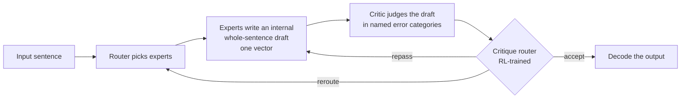

<div align="center">

# DiaGrad

**Route after the evidence, not before it.**

<sub>Posterior routing for Critique-Augmented Mixture-of-Experts, tested first on English↔Filipino.</sub>

</div>

DiaGrad is a research project on **posterior routing**: a Mixture-of-Experts model drafts a whole
sentence internally, a trained critic judges that draft in named error categories, and a small
critique router then accepts it, repasses it, or reroutes it to other experts. Filipino languages
are the first testbed, Japanese later. The project is built in public: decisions, the papers and
measurements behind them, failed runs and incidents are kept on the record, not tidied away.

**DiaGrad** is a research project developed under **SapinSapin AI**, led by **Arjhine Ty**. The
project's initial infrastructure and compute resources, including access to an NVIDIA GB10
workstation for the first research tranche, were provided by **Tim Santos**.

> **No model results yet.** Nothing here shows that posterior routing works. Tranche 1 is a
> feasibility gate for the sentence space the design needs; it is in progress.

---

## Current Status

| Item | Current state |
|---|---|
| Phase | **Tranche 1, feasibility gate.** Runs on one NVIDIA GB10 workstation ([D16](decisions/DECISIONS.md)) |
| Idea | Design, evaluation protocol and compute model written up as a research proposal (not part of this repository). Literature search logged: 151 queries in [`research/search/`](research/search/). "Not found in our searches" is not a novelty claim |
| Base model | [`google/madlad400-3b-mt`](https://huggingface.co/google/madlad400-3b-mt) (Apache-2.0), to carry a SONAR-style single-vector sentence space on permissive weights |
| Training data | 12 sources registered with pinned revisions, sha256 and quoted licences ([`data/registry/`](data/registry/)). Mix 3 measured: NLLB en-tl core plus 9 corpora adding **135.6M new MADLAD tokens** not in NLLB ([D22](decisions/DECISIONS.md), [measurement](data/mix/measure-mix3-2026-10-17.json)) |
| Held-out sets | SMOL (754 pairs) is the gate test, MASSIVE 1.1 tl-PH dev the dev set ([D19](decisions/DECISIONS.md)); contamination-checked against NLLB's bitext ([D20](decisions/DECISIONS.md), [summary](data/heldout/contamination-nllb-2026-10-08.json)) |
| Latest run | [`20261017-teacher-compare-1`](experiments/runs/20261017-teacher-compare-1/RUN.md) (exploratory): five permissive teachers (MADLAD-400 3B/7B/10B, Qwen3-14B/32B) against NLLB-200-3.3B on 1,000 dev pairs in each direction. NLLB is not ahead by more than 5 chrF++ in either direction, so NLLB/SONAR outputs stay out of training ([D25](decisions/DECISIONS.md)). chrF++ and a blind naturalness check disagree on en→fil |
| Error study E1 | Protocol drafted ([`studies/E1-error-study/`](studies/E1-error-study/)); waiting for native-speaker annotators |
| Preregistration | Draft, not frozen ([`prereg/PREREGISTRATION.md`](prereg/PREREGISTRATION.md)) |
| Largest current limitation | No trained model, no annotators yet, one GPU. Every claim on this page is about plans, data and infrastructure |

## Start Here

| I want to… | Start here |
|---|---|
| See why each decision was made | [Design decisions](decisions/DECISIONS.md): what was decided, why, and the papers and measurements behind each decision |
| See what is running and what failed | [Run index](experiments/runs/INDEX.md) · [Incident log](docs/INCIDENT_LOG.md) |
| Check where the data comes from | [Dataset registry](data/registry/) · [Source screening](data/registry/source_screening.json) (rejected candidates included) · [Data plan](data/DATA-PLAN.md) |
| Check a citation | [`research/papers/REFERENCES.md`](research/papers/REFERENCES.md): every cited paper with authors, exact version, licence and file hash |
| See the plan and schedule | [`ROADMAP.md`](ROADMAP.md) |
| Challenge something | [CONTRIBUTING.md](CONTRIBUTING.md) |

## How DiaGrad Works

An MoE router picks experts *before* they compute, and nothing reviews the result before it is
written. DiaGrad adds a second decision *after* the evidence.



- **Repass** runs the stage again with the critique as input; **reroute** biases expert selection
  away from the experts that produced the draft ([D9](decisions/DECISIONS.md)).
- The critic is a first-class, readable component, not a black box: it reports *which* kind of
  error it saw (meaning vs. surface form, [D2](decisions/DECISIONS.md)).
- The draft lives in a single-vector sentence space. SONAR has one but is non-commercially
  licensed, so tranche 1 builds a permissive one on MADLAD-400-3B with SONAR's published recipe.

## Tranche 1: the feasibility gate

Tranche 1 tests whether the drafts can carry what the design needs. It does **not** test whether
posterior routing improves translation; that is tranche 2. The pass rule (provisional; fixed in the
preregistration before training starts):

| Check | Passes if |
|---|---|
| Sentence space works | retrieval error ≤ 5% (en↔fil, SMOL); translation decoded from the vector ≥ 80% of MADLAD-400-3B's chrF++ |
| Meaning draft lacks surface form | linear-probe balanced accuracy ≤ 0.65 for *po/opo* and *ay*-inversion |
| Target draft carries it | reference encoding ≥ 0.85; the drafter's output, decoded, keeps the meaning, is not an average of forms, switches *po* with the register setting, and shows its form readably (D30) |

Any failure has a pre-stated consequence: simplify to one draft, revise the drafter, or stop.

## Results So Far

These are measurements about data and infrastructure, not model quality.

**Training-data volume (Mix 3).** MADLAD-400 tokens, English + Filipino, EOS on each side. "New" means
the pair does not appear anywhere in NLLB en-tl (63.6M lines) after normalisation, and is counted
once across sources ([full table](data/mix/measure-mix3-2026-10-17.json)).

| Source | Pairs | Tokens | Pairs also in NLLB | New pairs |
|---|---:|---:|---:|---:|
| CCMatrix v1 | 3,113,828 | 101.7M | 5.4% | 2,828,188 |
| OpenSubtitles v2024 | 1,072,914 | 21.8M | 1.0% | 866,948 |
| ParaCrawl v9 | 248,689 | 20.6M | 24.3% | 180,993 |
| WikiMatrix v1 | 75,446 | 5.1M | 15.8% | 63,533 |
| bible-uedin v1 | 62,195 | 4.8M | 8.7% | 55,937 |
| QED v2.0a (tl + fil) | 45,956 | 1.7M | 1.6% | 40,642 |
| eBible (tglulb–engwebp) | 30,958 | 2.3M | 0.1% | 30,834 |
| Global Voices 2018Q4 | 2,517 | 0.2M | 21.3% | 1,941 |
| **All nine, deduplicated** | **4,279,806 distinct** | | | **4,060,618 (135.6M tokens)** |

NLLB's top 3.5M pairs by LASER3 score add about 169M tokens before filtering, so the raw mix is about
305M tokens, above the 200–250M target. Half of CCMatrix's Filipino sentences also occur in NLLB, paired
with different English, so the second-opinion filter planned in D22 decides what survives.

**Teacher comparison.** 1,000 MASSIVE-dev pairs per direction; chrF++ with 95% paired-bootstrap
intervals; naturalness 0–2 from a blind LLM judge (Codex) on 50 outputs per model and direction
([run record](experiments/runs/20261017-teacher-compare-1/RUN.md), [scores](experiments/runs/20261017-teacher-compare-1/scores.json)).

| Model | en→fil chrF++ | en→fil naturalness | fil→en chrF++ | fil→en naturalness |
|---|---:|---:|---:|---:|
| MADLAD-400-3B | 57.5 | 1.00 | 63.5 | 1.62 |
| MADLAD-400-7B | 58.4 | 1.14 | **64.1** | 1.64 |
| MADLAD-400-10B | 58.0 | 1.14 | 63.4 | 1.60 |
| Qwen3-14B | 51.4 | 1.60 | 60.5 | 1.70 |
| Qwen3-32B | 52.5 | **1.62** | 61.3 | 1.70 |
| NLLB-200-3.3B (evaluation only) | **63.1** | 1.58 | 60.9 | 1.70 |

- On fil→en every MADLAD model is ahead of NLLB (by 2.5–3.2 chrF++, intervals above zero).
- On en→fil NLLB leads MADLAD-7B by 4.8 [3.7, 5.8] chrF++, inside the 5-point threshold set before the run.
- The two measures disagree on en→fil: MADLAD has the higher chrF++ but the lower naturalness. On these
  short voice-assistant commands it often translates word for word, which chrF++ rewards for word
  overlap. Choosing a back-translation teacher by chrF++ alone would have chosen the less natural one.
- The judge is an LLM, not a human (see [limitations](#current-limitations)); one seed, one domain.
- GB10 throughput (sentences/s, en→fil / fil→en): MADLAD-3B 27 / 6.5, MADLAD-10B 12 / 3.0, Qwen3-32B
  2.1 / 3.4, NLLB 30 / 34. NLLB is evaluation-only: its outputs never become training data.

## Rules This Project Holds Itself To

- **Licences.** Nothing non-commercial ends up inside the model: no SONAR or NLLB weights, and no
  training data generated by non-commercial models. Research runs may train on non-commercially
  licensed *datasets*; their results are labelled research-only ([D15](decisions/DECISIONS.md)).
- **Evidence for decisions.** Every decision records the hypothesis, the papers (from
  [`references.bib`](research/papers/references.bib) only, never from memory), our measurements, and
  what would show it wrong ([design decisions](decisions/DECISIONS.md)).
- **Evaluation.** A metric used to train or select the critic is never the evidence that the method
  works. No automatic metric is validated for Philippine languages, so human evaluation is the main
  evidence. Results are reported per language.
- **Held-out data** is never trained on, and headline claims use only our own held-out sets or
  hidden splits ([A5](research/diligence/A5-contamination.md)).
- **Runs.** Each run record is written before the run; failures stay on the record
  ([`experiments/README.md`](experiments/README.md)).

## Current Limitations

- **No model results.** Tranche 1 has not trained anything yet.
- **One GPU, shared.** All tranche-1 work runs on one GB10 (121 GB shared CPU/GPU memory). Out-of-memory
  incidents are in the [incident log](docs/INCIDENT_LOG.md).
- **No human evaluation yet.** E1 and the labelling of the NLLB sample wait for native-speaker
  annotators. An LLM judge (Codex) is used only as an advisory check, never as evidence.
- **Licence status of the training data.** Most English–Filipino parallel text has no clear licence for
  redistribution. Every source's status is recorded; a normalised dataset will be published only with
  each source's terms checked ([D21](decisions/DECISIONS.md)).
- **Single seeds.** Exploratory runs so far use one seed and are not confirmatory.

## Reproducing

Tranche-1 code runs in a pinned container on the GB10 (aarch64, CUDA 13.0); see
[`experiments/T1-SETUP.md`](experiments/T1-SETUP.md) and [`env/`](env/). The CPU-only checks run
anywhere:

```bash
git clone https://github.com/arjhinety/Dia-Grad.git
cd Dia-Grad
python3 -m venv .venv && . .venv/bin/activate
pip install pytest numpy pyyaml sacrebleu==2.6.0

PYTHONPATH=src pytest --ignore=tests/test_t1.py       # the GPU/tokenizer tests need the container
PYTHONPATH=src python -m diagrad.registry.validate    # dataset registry and screening log
python scripts/check_publication_hygiene.py           # secrets, private paths, leftover notes
```

> **Passing checks validate records and code contracts, not research results.**

Data files are never committed: the registry pins their revision and sha256, so they can be fetched
and verified. Paper PDFs are kept locally for the same reason (licences); their hashes are in
[`research/papers/registry.json`](research/papers/registry.json).

## Repository Structure

```text
ideas/          the idea, its refinement, and the question log
hypotheses/     architecture variants and why the critique must be architectural
decisions/      decision log (D1–D26) and the evidence behind each decision
prereg/         preregistration draft
research/       paper library and provenance tool, search log, licence audit, diligence (A4–A7)
data/           dataset registry, data plan, mix measurements, held-out summaries (no raw data)
studies/        E1, the English→Filipino MT error study
experiments/    run conventions, configs, run records (successes and failures)
src/diagrad/    tranche-1 code: sentence space, gate, contamination check, teacher comparison, registry
tests/          tests for src/
env/            pinned container for the GB10
scripts/        repository checks
docs/           incident log
```

The full folder map, file by file: [`docs/FOLDER-MAP.md`](docs/FOLDER-MAP.md).

**This public repository is a filtered snapshot** of the project's working repository. Left out:
dataset rows (fetched by revision and sha256 instead), the written research proposal, internal working records,
project-management and presentation notes, and research-pipeline scratch files. Some records still
name those files. [`PUBLIC-SNAPSHOT.json`](PUBLIC-SNAPSHOT.json) records the source commit and the number
of files left out in each category.

## How This Was Built (AI disclosure)

Much of the code and documentation was written with AI assistance (Anthropic's Claude). The
research questions, design decisions and the evaluation of results are the author's.

## Contributing

Corrections, failed reproductions, data-licence findings and Filipino-language expertise are all
welcome. See [CONTRIBUTING.md](CONTRIBUTING.md). Do not commit datasets, checkpoints or credentials.

## Related Projects

- [OpenGrad](https://github.com/arjhinety/OpenGrad) — Arjhine Ty's reproducible post-training research
  repository; DiaGrad's dataset-record scheme is ported from it ([D24](decisions/DECISIONS.md)).

DiaGrad records upstream datasets, models and papers in its registries; those sources remain subject
to their own licences and attribution requirements ([NOTICE](NOTICE)).

## Citation and License

Please cite the repository using [CITATION.cff](CITATION.cff) until a paper exists.
Contact: Arjhine Ty — [arjhine@experimentalmachines.org](mailto:arjhine@experimentalmachines.org).

Source code and documentation are licensed under [Apache-2.0](LICENSE); third-party content keeps its
own terms ([NOTICE](NOTICE)).
